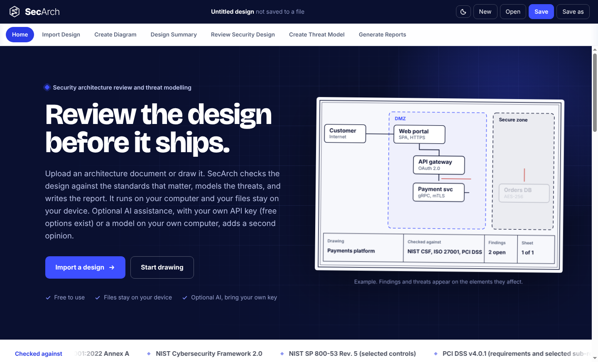

# SecArch Desktop

**Security architecture review and threat modelling for Windows and macOS.**

Import a design or draw it, get it reviewed against the standards you choose, model the threats and produce the report. SecArch runs on your computer. There is no sign in, no account and no server, and your designs stay in files on your device.

> This repository contains the **installers and documentation only**. The source code is not published here.

## Download

Get the latest installer from the **[Releases page](../../releases/latest)**.

| Your computer | File | Size | Requires |
|---|---|---|---|
| **Windows** | `SecArch-Setup-0.1.0-x64.exe` | about 153 MB | Windows 10 or 11, 64 bit |
| **macOS** | `SecArch-0.1.0-universal.pkg` | about 254 MB | macOS 13 Ventura or later. Apple silicon and Intel. |

Checksums for both files are in [`SHA256SUMS.txt`](SHA256SUMS.txt) so you can confirm your download.

## Expect a security warning the first time

The installers are not yet signed with a paid Microsoft or Apple publisher certificate. Windows and macOS therefore show a warning the first time you open them. **This is expected.** It does not mean the file is damaged. You choose to trust it:

* **Windows:** *Windows protected your PC*. Click **More info**, then **Run anyway**.
* **macOS:** *Not Opened*. Click **Done**, then open **System Settings, Privacy & Security** and click **Open Anyway** beside the SecArch message.

Step by step instructions with every screen:

* **[Install on Windows](docs/install-windows.md)**
* **[Install on macOS](docs/install-macos.md)**

Only install files that you downloaded from this repository's Releases page, and check the checksum.

## Documentation

| Guide | What it covers |
|---|---|
| [Install on Windows](docs/install-windows.md) | Download, checksum, SmartScreen and browser warnings, setup wizard, first start, update and removal. |
| [Install on macOS](docs/install-macos.md) | Download, checksum, Gatekeeper block and Open Anyway, installer, first start, Terminal alternative, update and removal. |
| [User guide](docs/user-guide.md) | The whole app, end to end: import or draw, design summary, security review, threat model, reports, saving, and a worked example. |
| [Optional AI assistance](docs/ai-assistance.md) | Adding a second opinion with your own key or a local model. Off by default. |
| [Privacy and data](docs/privacy-and-data.md) | What is stored, where, and when anything leaves your computer. |
| [Troubleshooting](docs/troubleshooting.md) | Fixes for install warnings and common problems. |

## What SecArch does

* **Import or draw.** Read a Word, PowerPoint, Visio, draw.io, PDF, Mermaid, PlantUML, Graphviz, Terraform, CloudFormation, Kubernetes, OpenAPI, JSON, text or image file, or draw the architecture on a canvas with thousands of AWS, Azure, Google Cloud and generic components.
* **Review.** Check the design against confidentiality, integrity, availability and resilience requirements, mapped to the standards you switch on: ISO/IEC 27001, NIST CSF 2.0, NIST SP 800-53, PCI DSS, the OWASP Top 10 lists, CIS Controls and Benchmarks, DORA, the EU AI Act and more. Triage every finding with a status, owner, due date and justification.
* **Model threats.** STRIDE, PASTA or OCTAVE Allegro, with threat actors, MITRE ATT&CK references, a risk heat map and recommendations.
* **Report.** PDF and Excel reports for the review and the threat model.
* **Stay private.** Files are plain `.secarc` files on your computer. The app blocks network access, other than the optional AI providers you choose to turn on.
* **Optional AI.** Bring your own key (Groq, Google Gemini, OpenRouter, Claude, OpenAI) or run a model on your own computer with Ollama.

## Good to know

* SecArch supports a security review. It is not a certification, an audit opinion or legal advice. The shipped standards and rules are marked draft until a specialist reviews them, and reports say so.
* Updates are not automatic. Download the newer installer from the Releases page and run it over the old version. Your files and session history are kept.

## Help

Read the [Troubleshooting](docs/troubleshooting.md) page, or [open an issue](../../issues). Please do not attach confidential designs.

## Notices

SecArch is free to use. It is not open source and the source code is not published. Copyright Michael Davids. Provided as is, without warranty. See [THIRD-PARTY-NOTICES.md](THIRD-PARTY-NOTICES.md) for third party components.
