# SecArch Desktop user guide

A complete walk through of SecArch, from opening the app to handing over a finished report. Every step uses the real screens of the app. Keyboard shortcuts show **Ctrl** for Windows and **Cmd** for macOS.

**Contents**

1. [What SecArch does](#1-what-secarch-does)
2. [The five minute path](#2-the-five-minute-path)
3. [The window, menus and shortcuts](#3-the-window-menus-and-shortcuts)
4. [Step 1: Start a design (import or draw)](#4-step-1-start-a-design-import-or-draw)
5. [Step 2: Create the diagram](#5-step-2-create-the-diagram)
6. [Step 3: Complete the design summary](#6-step-3-complete-the-design-summary)
7. [Step 4: Review the security design](#7-step-4-review-the-security-design)
8. [Step 5: Create the threat model](#8-step-5-create-the-threat-model)
9. [Step 6: Generate the reports](#9-step-6-generate-the-reports)
10. [Saving, reopening and session history](#10-saving-reopening-and-session-history)
11. [Optional AI assistance](#11-optional-ai-assistance)
12. [A complete worked example](#12-a-complete-worked-example)
13. [Tips for a good review](#13-tips-for-a-good-review)
14. [Limits you should know about](#14-limits-you-should-know-about)

## 1. What SecArch does

SecArch helps you review the security of a system design before it is built or changed. You describe the design (by importing a document or drawing it). SecArch then:

* **Reviews** the design against confidentiality, integrity, availability and resilience requirements, and maps each requirement to the standards you have switched on (ISO/IEC 27001, NIST CSF, NIST SP 800-53, PCI DSS, the OWASP lists, CIS Controls and Benchmarks, DORA, EU AI Act and others).
* **Models threats** with STRIDE, PASTA or OCTAVE Allegro, using a built in threat library and MITRE ATT&CK references.
* **Writes reports** as PDF and Excel files.

It runs on your computer. There is no account and no sign in. Your designs stay in files on your computer.

## 2. The five minute path

1. **Import Design**: paste text or choose a document, then click **Build diagram and generate reports**.
2. **Create Diagram**: check the drawing and fix anything wrong.
3. **Design Summary**: answer the scope questions and add data assets.
4. **Review Security Design**: click **Run review** and work through the findings.
5. **Create Threat Model**: click **Regenerate** and review the threats.
6. **Generate Reports**: download the PDFs and spreadsheets.
7. **Save** (Ctrl or Cmd + S) to keep your work as a `.secarc` file.

## 3. The window, menus and shortcuts

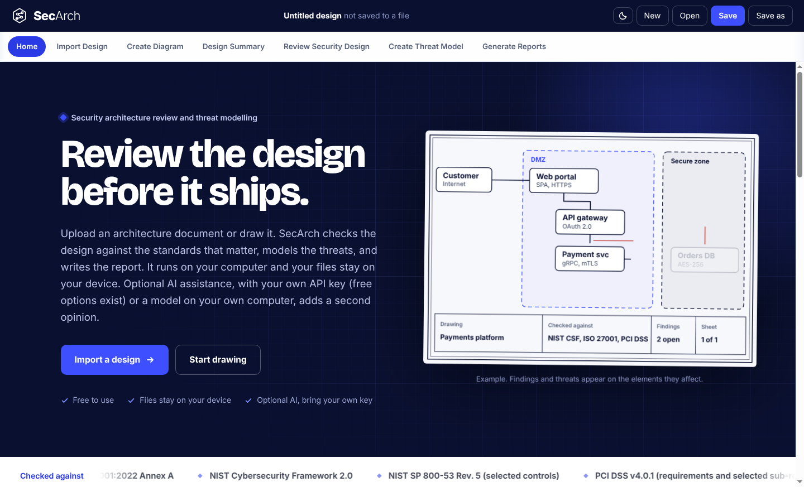

**The header** shows the name of the design and, beside it, the file it is saved to. It shows **not saved to a file** for a new design and **(unsaved changes)** when you have edited it since the last save. On the right:

| Control | What it does |
|---|---|
| Moon icon | Switches between light and dark theme. |
| **New** | Starts a new empty design. |
| **Open** | Opens a `.secarc` project file, or a draw.io diagram. |
| **Save** | Saves the design to its file. The first time it asks where to save. |
| **Save as** | Saves a copy under a new name or in a new place. |

**The tabs** run left to right in the order you normally work: **Home**, **Import Design**, **Create Diagram**, **Design Summary**, **Review Security Design**, **Create Threat Model**, **Generate Reports**.

**The menu bar** (at the top of the window on Windows, at the top of the screen on macOS):

| Menu | Items |
|---|---|
| **File** | New design (Ctrl or Cmd + N), Open... (Ctrl or Cmd + O), Open Recent (last ten files, with **Clear recent files**), Save (Ctrl or Cmd + S), Save As... (Ctrl or Cmd + Shift + S), Quit (Windows) or Close (macOS). |
| **Edit** | Undo, Redo, Cut, Copy, Paste, Select All. |
| **Sessions** | Past working sessions, newest first, with the time of the last change. Click one to return to it. **Clear session history** removes them. |
| **View** | Jump to each tab (Ctrl or Cmd + 1 to 7, in tab order), **Switch light or dark theme**, **AI settings...**, zoom in, zoom out, reset zoom, full screen. |
| **Window** | Standard window controls. |
| **Help** | **About SecArch**, **Privacy notice**, **Show app data folder**, and the version number. |

## 4. Step 1: Start a design (import or draw)

You can start in three ways. Use the one that matches what you have.

| You have | Do this |
|---|---|
| An architecture document, diagram file or infrastructure code | **Import Design** (this section). |
| Nothing yet | **Home**, **Start drawing**, or **File, New design**, then [draw the diagram](#5-step-2-create-the-diagram). |
| A SecArch `.secarc` file | **Open**. See [Saving and reopening](#10-saving-reopening-and-session-history). |

### Import a design

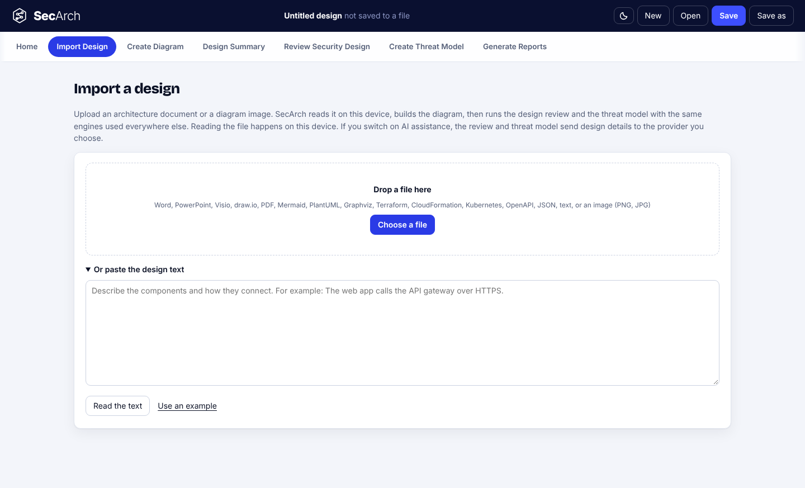

1. Click the **Import Design** tab.
2. Add your design in one of two ways:
   * Drag a file onto **Drop a file here**, or click **Choose a file**.
   * Click **Or paste the design text**, then paste or type a description. Click **Use an example** to fill in a sample.
3. Supported inputs: Word, PowerPoint, Visio, draw.io, PDF, Mermaid, PlantUML, Graphviz, Terraform, CloudFormation, Kubernetes, OpenAPI, JSON, plain text, and images (PNG, JPG). Reading happens on your computer. For images, the text in the picture is read on your computer too.
4. If you pasted text, click **Read the text**.

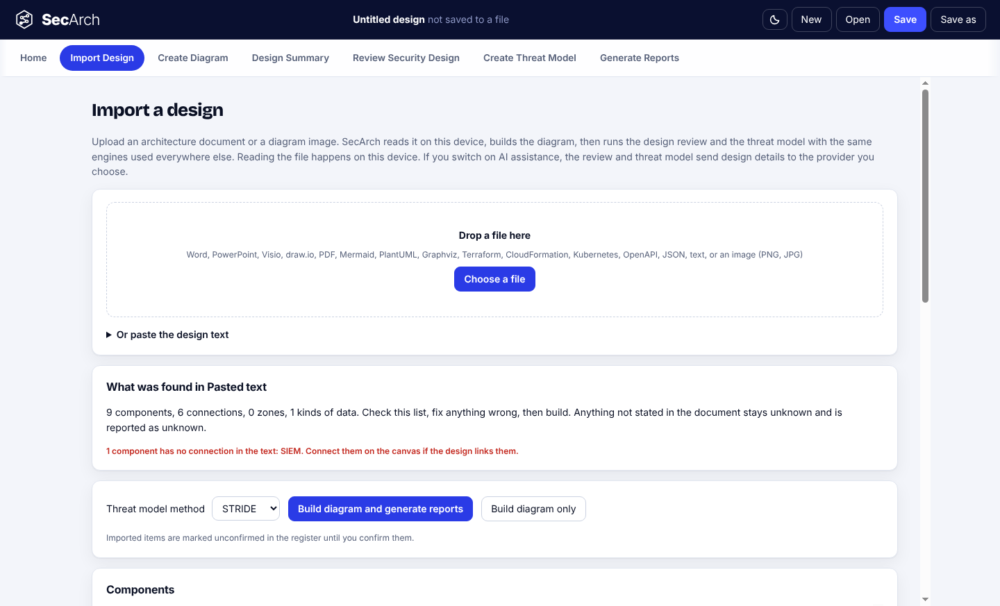

5. A box titled **What was found** reports how many components, connections, zones and kinds of data SecArch found. It also warns about problems, for example a component with no connection. Scroll down to the **Components** list and the other lists. Check them, fix anything wrong, and remove anything that should not be there.
6. Choose the **Threat model method** (STRIDE, PASTA or OCTAVE Allegro).
7. Click one of:
   * **Build diagram and generate reports**, which builds the diagram, runs the review and the threat model.
   * **Build diagram only**, which only builds the diagram so you can edit it first.

Anything the document does not state stays **unknown** and the review reports it as unknown. Imported items are marked unconfirmed in the register until you confirm them.

## 5. Step 2: Create the diagram

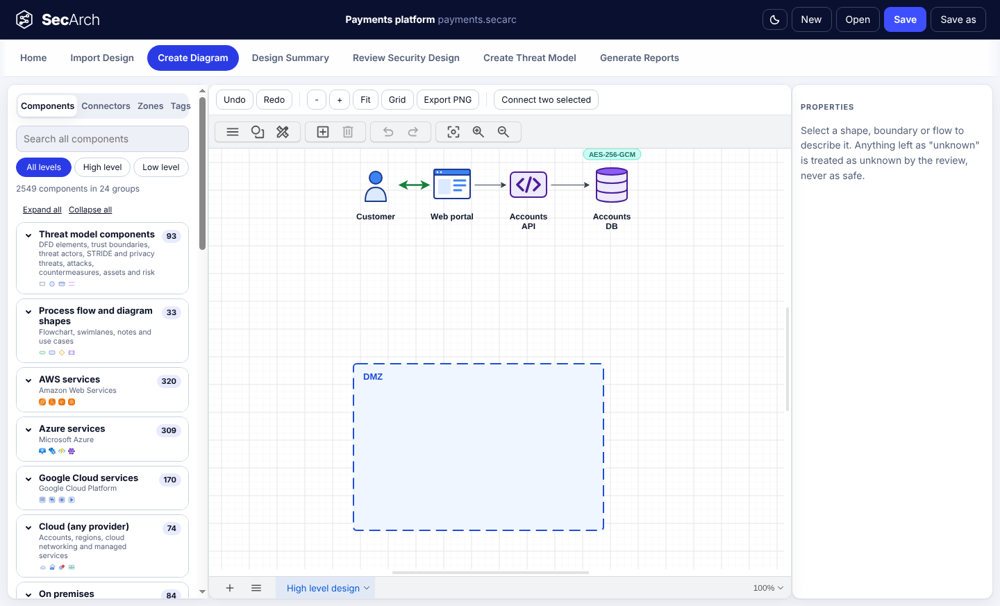

The diagram is the source of the review. Each shape is a component. Each arrow is a data flow. Each dashed box is a trust boundary (zone). The editor works offline.

### The left panel (palette)

Four tabs sit at the top of the left panel.

**Components.** Type in **Search all components**, or pick a level (**All levels**, **High level**, **Low level**). Components are grouped, for example *Threat model components*, *Process flow and diagram shapes*, *AWS services*, *Azure services*, *Google Cloud services*, *Cloud (any provider)* and *On premises*. Use **Expand all** and **Collapse all** to open or close the groups. To add a component, click it, or drag it onto the canvas.

**Connectors.** Choose how two components are joined. Select a connection and click a type to change it. Select two shapes and click a type to join them. With nothing selected, the type you click is used for the next connection you draw. Types include **Data flow**, **Two way data flow**, **Direct link**, **Curved flow**, **Line, no arrow**, and protected types such as **Encrypted flow (TLS)**.

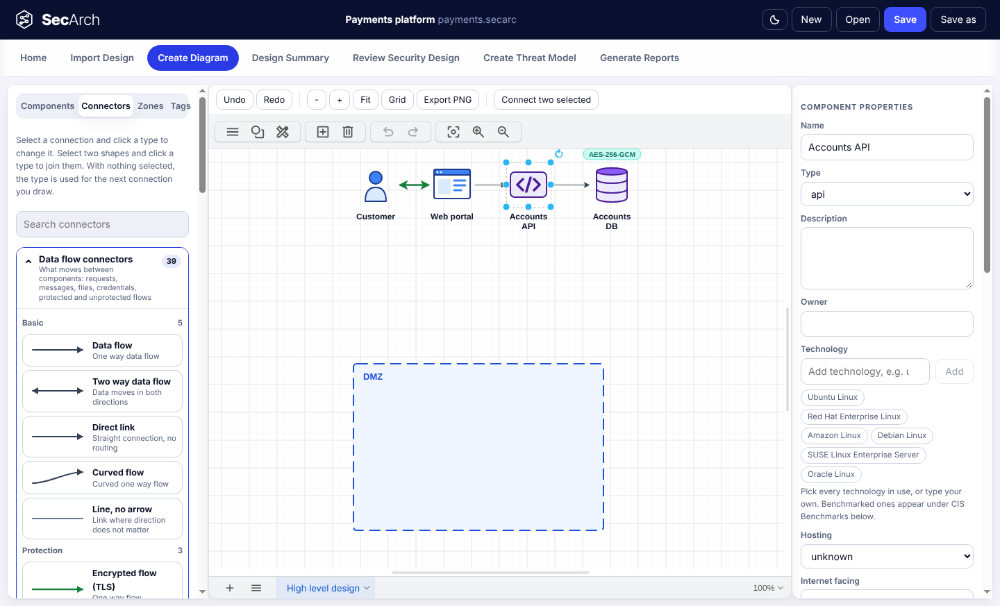

**Zones.** Trust boundaries such as **Internet (untrusted)**, **DMZ**, **Internal network**, **Application tier**, **Data tier**, **Management network** and **High security zone**, plus organisation and cloud boundaries (AWS account, VPC, Azure subscription and others). Each has a trust level from 0 (untrusted) to 5 (highest). Drag shapes inside a zone to place them in it. The trust level feeds the review.

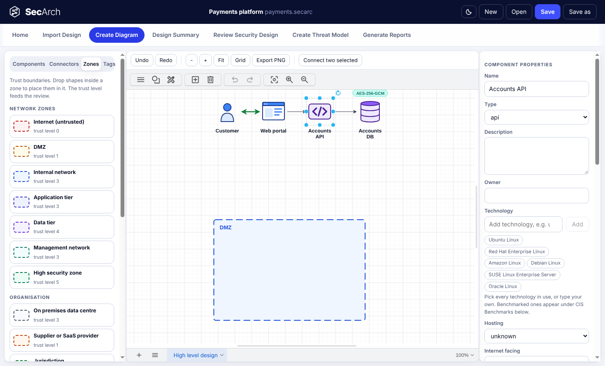

**Tags.** Security tags describe algorithms, protocols and practices, such as TLS 1.3, OpenID Connect or AES-256. Select one or more components or flows, then click a tag to add or remove it. Search for a tag by name. Tags shown in red are weak or deprecated choices (for example TLS 1.0, HTTP or SMB 1) and the review flags them.

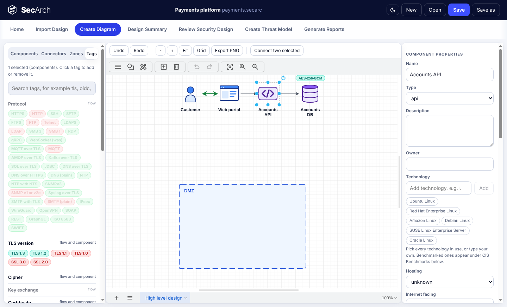

### Draw and connect

1. **Add components** by clicking or dragging them from the palette.
2. **Draw a flow** by hovering over a shape and dragging its blue arrow to another shape. Or select two shapes and click **Connect two selected** in the toolbar.
3. **Place components in zones** by dropping them inside a zone box.
4. **Move and resize** shapes by dragging them or their handles.

### The toolbar

| Button | Use |
|---|---|
| **Undo**, **Redo** | Step back or forward through edits. |
| **-**, **+**, **Fit** | Zoom out, zoom in, fit the whole drawing in view. |
| **Grid** | Show or hide the grid. |
| **Export PNG** | Save the diagram as an image. |
| **Connect two selected** | Join the two selected shapes with the chosen connector. |

Below the toolbar is the drawing editor's own toolbar for formatting, deleting, and zoom. The bottom bar holds the page tabs (for example **High level design**), the **+** button to add a page, and the zoom level.

### The properties panel

Select anything on the canvas and the right panel shows what you can say about it. Anything you leave as **unknown** is treated as unknown by the review, never as safe.

**Component properties:**

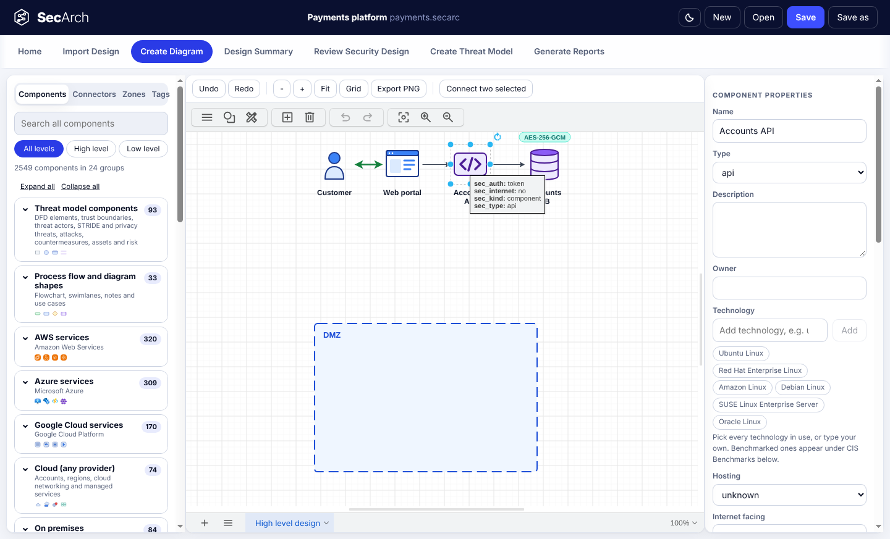

* **Name**, **Type** (process, service, web-app, api, data-store, external-entity, user, compute, container, function, queue, gateway, network-device, identity-provider, ai-model, third-party-service, other), **Description**, **Owner**.
* **Technology**: add every technology in use (for example Ubuntu Linux or Kubernetes). Technologies with a CIS Benchmark appear under **CIS Benchmarks** below.
* **Hosting** (on-prem, cloud, saas, hybrid), **Internet facing**.
* **Primary authentication** (none, password, mfa, mtls, token, oidc, saml, api-key, other, unknown), **Authentication methods** and **Authorisation models** (RBAC, ABAC, ACL, ReBAC, PBAC, MAC). Weak methods are flagged by the review.
* **Encrypted at rest**, **Security logging**, **Redundancy**.
* Tick boxes: **Supports a critical or important function (DORA)**, **Third party operated**, **In payments scope (PCI DSS)**, and the **RTO** and **RPO** in minutes.
* **CIS Benchmarks**: tick the benchmark levels already implemented and the review will not ask for them again.

**Flow properties:**

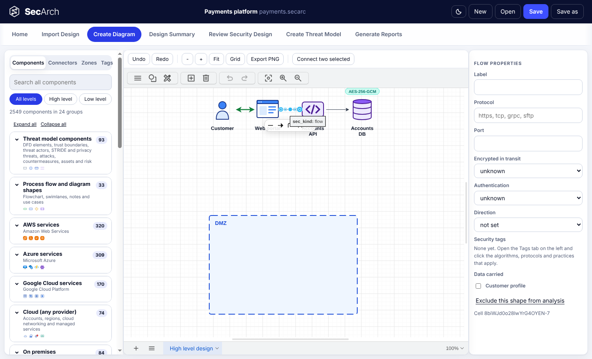

* **Label**, **Protocol** (for example https, tcp, grpc, sftp), **Port**.
* **Encrypted in transit** (unknown, yes or no) and **Authentication** (the method used, or none).
* **Direction**.
* **Security tags** (add from the **Tags** tab).
* **Data carried**: tick each data asset this flow carries. Data assets are created in the **Design Summary** tab.
* **Exclude this shape from analysis** removes a shape from the review.

**Boundary properties:** **Name**, **Type** (network-zone, cloud-account, process, organisation, jurisdiction), **Trust level (0 untrusted, 5 highest)** and **Description**.

## 6. Step 3: Complete the design summary

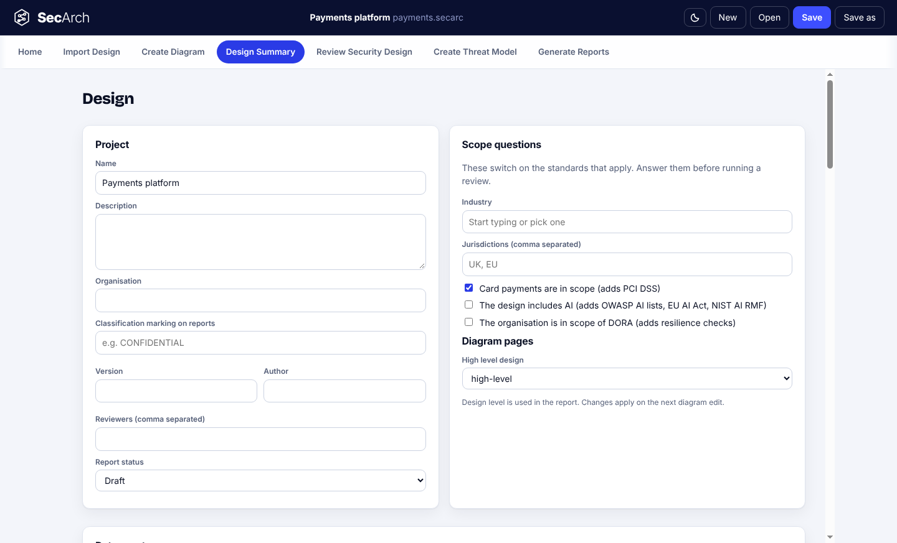

Open **Design Summary**. This tab holds what the diagram cannot show. The more you state here, the more precise the requirements and threats are.

### Project

Fill in **Name**, **Description**, **Organisation**, **Classification marking on reports** (for example CONFIDENTIAL), **Version**, **Author**, **Reviewers** (comma separated) and **Report status** (**Draft** or **Final**). These appear on the reports.

### Scope questions

These switch on the standards that apply. Answer them before you run a review.

* **Industry** and **Jurisdictions** (for example UK, EU).
* **Card payments are in scope (adds PCI DSS)**.
* **The design includes AI (adds OWASP AI lists, EU AI Act, NIST AI RMF)**.
* **The organisation is in scope of DORA (adds resilience checks)**.

### Diagram pages

Set the **design level** of each page (context, high-level, low-level, data-flow). The level is used in the report.

### Data assets

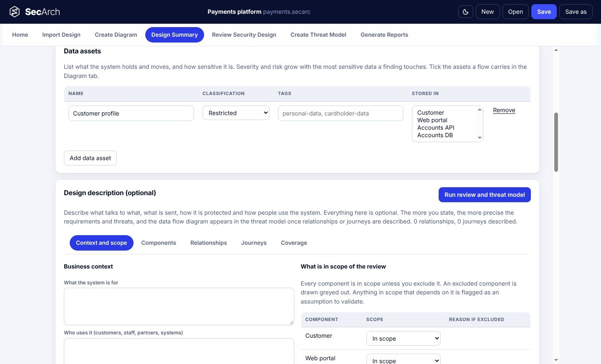

List what the system holds and moves, and how sensitive it is. Severity and risk grow with the most sensitive data a finding touches.

1. Click **Add data asset**.
2. Enter the **Name**.
3. Choose the **Classification** (**Public**, **Internal**, **Confidential**, **Restricted**).
4. Add **Tags** for regulated data, for example `cardholder-data` or `personal-data`.
5. Under **Stored in**, tick the components that store it.
6. Tick the asset on each flow that carries it, in the **Create Diagram** tab (flow properties, **Data carried**).

Click **Remove** to delete an asset.

### Design description (optional)

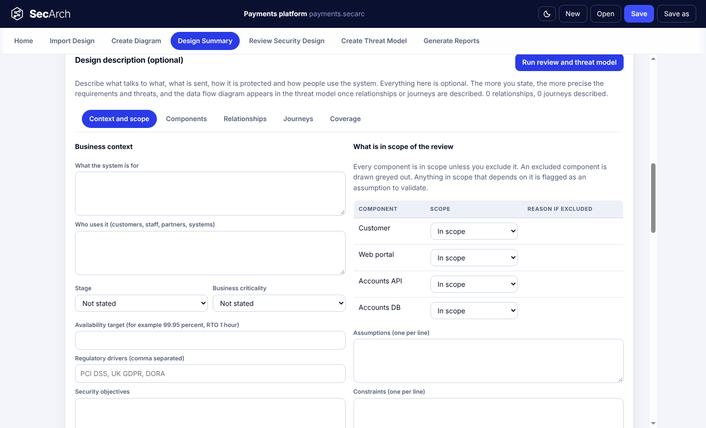

Five sub tabs let you describe the system in words and facts. Everything here is optional.

| Sub tab | What to enter |
|---|---|
| **Context and scope** | What the system is for, who uses it, stage, business criticality, availability target, regulatory drivers, security objectives, controls already in place, known risks, open questions. A table lets you mark each component **In scope** or **Out of scope** (with a reason). You can also list assumptions and constraints. |
| **Components** | Pick a component and describe what it does, the data it holds, key management, where secrets are kept, privileged access, whether an administration interface is exposed, backups, patching, monitoring, input validation and session management. |
| **Relationships** | Describe each conversation between two components. **Create from diagram arrows** starts the list from your diagram. Add one relationship for each direction of conversation. |
| **Journeys** | Follow one use of the system from first component to last, for example a customer payment or an administrator change. Add one step per hop and say what is checked at that hop. |
| **Coverage** | Shows how much you have described. The data flow diagram in the threat model is built once you describe at least one relationship or journey step. |

At the bottom of the tab:

* **Completeness** shows the percentage of security facts you have stated and lists, per component and flow, what is **not yet stated**. Unknown facts are never assumed safe. The review reports them as gaps in what it could check.
* **Content packs** lists every standard, rule set and the threat library, with a tick to switch each on or off. Use **Import a pack file** to add your own.

The blue **Run review and threat model** button above the sub tabs runs both in one go.

## 7. Step 4: Review the security design

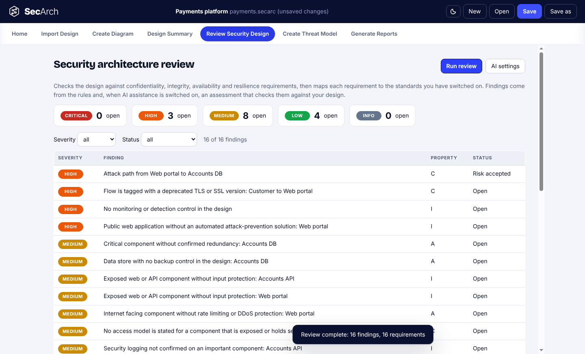

1. Open **Review Security Design**.
2. Click **Run review**. (Add AI assessment first if you want it: see [section 11](#11-optional-ai-assistance).)
3. The summary shows how many findings are **Critical**, **High**, **Medium**, **Low** and **Info**, counted as open. A note tells you if earlier findings no longer apply because the design changed.
4. Use the **Severity** and **Status** filters above the table. The table lists each finding with its severity, the affected element, the property it affects (C confidentiality, I integrity, A availability, R resilience) and its status.

### Open a finding

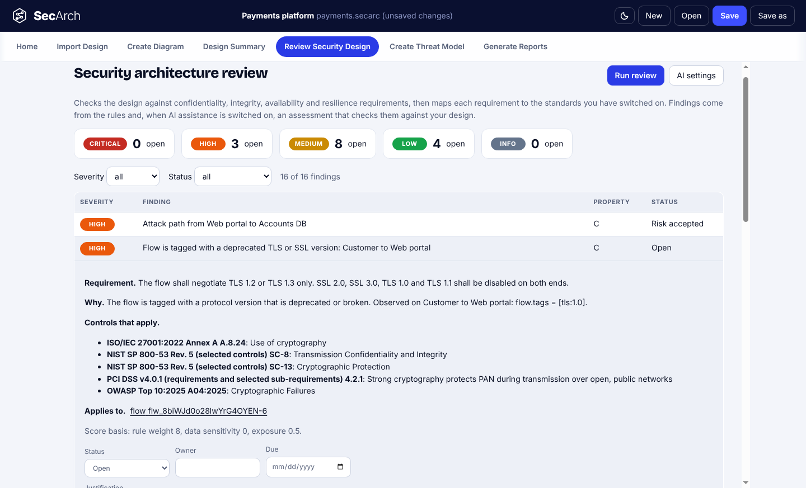

Click a row. The detail shows:

* **Requirement**: what the design must do.
* **Why**: the facts from your design that triggered it.
* **Controls that apply**: the exact controls from the standards you switched on (for example ISO/IEC 27001 A.8.24, NIST SP 800-53 SC-8, PCI DSS 4.2.1).
* **Applies to**: the element the finding is about.
* **Score basis**: how severity was calculated. Severity grows with the weight of the rule, the sensitivity of the data touched, internet exposure and the number of trust boundaries crossed. The same design always scores the same.

### Triage each finding

At the bottom of the detail, set:

| Field | Meaning |
|---|---|
| **Status** | **Open**, **Fixed**, **Risk accepted** or **Not applicable**. |
| **Owner** | Who is responsible. |
| **Due** | Target date. |
| **Justification** | Why you accepted the risk, or how it was fixed. |

Your triage decisions are kept when you run the review again. If a finding you marked **Fixed** is detected again, it is reopened with a note.

To fix a finding properly, change the design (diagram, properties or design summary) and click **Run review** again.

### Standards coverage

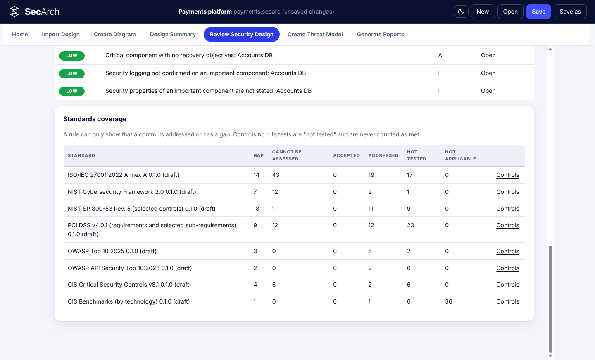

Below the findings, a table shows each standard you switched on, with counts for every control:

| Status | Meaning |
|---|---|
| **Gap** | A rule found an open problem for this control. |
| **Addressed** | A rule tested this control and found no open problem. |
| **Accepted** | The only findings are marked risk accepted. |
| **Not tested** | No rule tests this control. It is never counted as met. |
| **Cannot be assessed** | The control cannot be judged from a design. |
| **Not applicable** | The control does not apply to this design. |

Click **Controls** on a row to list the controls and the findings behind each.

## 8. Step 5: Create the threat model

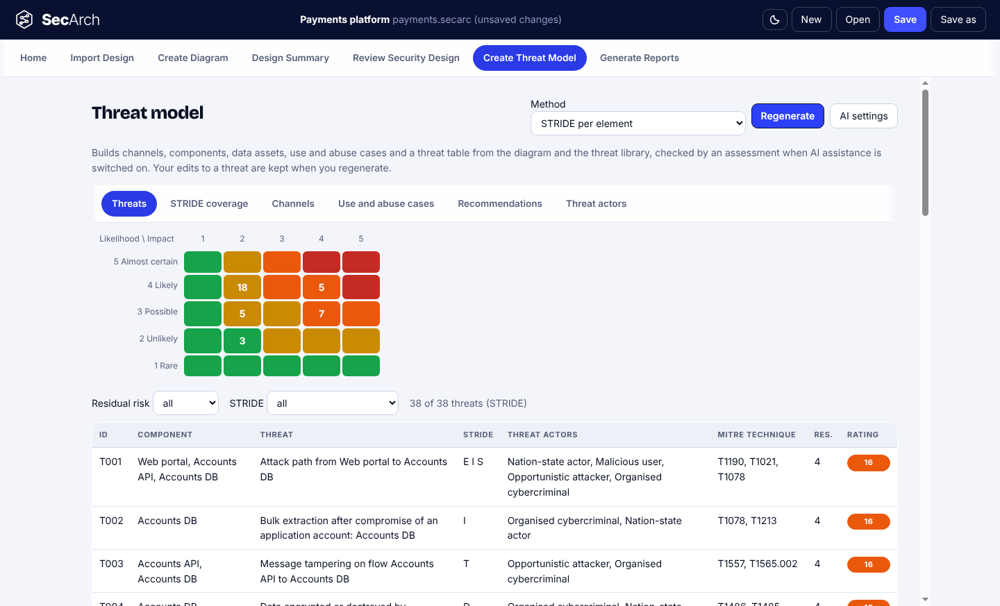

1. Open **Create Threat Model**.
2. Choose the **Method**: **STRIDE per element**, **PASTA (attack centric, 7 stages)** or **OCTAVE Allegro (asset centric)**.
3. Click **Regenerate**. SecArch builds channels, components, data assets, use and abuse cases and a threat table from your diagram and the threat library.

### Read the results

* **Heat map**: likelihood against impact. The number in each cell is how many threats sit there.
* **Filters**: **Residual risk** and **STRIDE** category.
* **Threat table**: ID, component, threat, STRIDE categories, threat actors, MITRE technique, residual score (**RES.**) and rating.

### Work with a threat

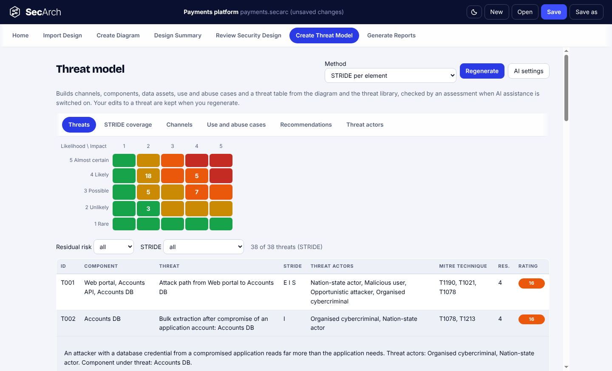

Click a row to see the description, affected components, MITRE techniques, a recommendation, and the impact with inherent and residual likelihood. Then set:

| Field | Options |
|---|---|
| **Treatment** | undecided, mitigate, accept, transfer, avoid |
| **Status** | draft, confirmed, mitigated, accepted, closed |
| **Owner** | Person responsible |
| **Treatment justification** | Why you chose this treatment |
| **Override** | Set the inherent or residual likelihood yourself |

Your edits are kept when you click **Regenerate** again.

### The other sub tabs

| Sub tab | Content |
|---|---|
| **Threats** | The table above. |
| **STRIDE coverage** | A table of every component and flow against the six STRIDE categories. A number is how many threats cover that cell. A dash means the category does not apply. |
| **Channels** | How each data flow is protected in transit: protocol, mechanism, authentication, a status such as **WEAK** or **UNKNOWN**, the gap, and the recommended mechanism. |
| **Use and abuse cases** | Normal use of the system, listed next to the abuse cases an attacker could try. |
| **Recommendations** | Recommended controls grouped so that one control closes several threats, each with a priority (P1, P2 and so on) and a time to act within. |
| **Threat actors** | The attacker types considered, with capability, motivation, the number of threats each is linked to, and a description. |

## 9. Step 6: Generate the reports

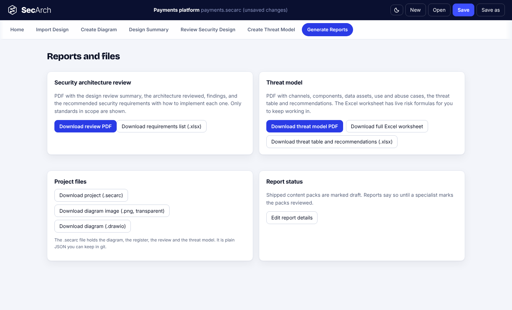

Open **Generate Reports**. Each button saves a file. The app asks where to save it.

| Section | File |
|---|---|
| **Security architecture review** | **Download review PDF** (design review summary, the architecture reviewed, findings, and the recommended security requirements with how to implement each one). **Download requirements list (.xlsx)**. |
| **Threat model** | **Download threat model PDF** (channels, components, data assets, use and abuse cases, threat table, recommendations). **Download full Excel worksheet** (with live risk formulas). **Download threat table and recommendations (.xlsx)**. |
| **Project files** | **Download project (.secarc)**. **Download diagram image (.png, transparent)**. **Download diagram (.drawio)**. |

**Edit report details** takes you to the project fields (name, organisation, classification marking, version, author, reviewers, report status).

The shipped standards and rule sets are marked draft until a specialist reviews them, and the reports say so. See [Limits you should know about](#14-limits-you-should-know-about).

## 10. Saving, reopening and session history

### Save your work

1. Click **Save** or press **Ctrl or Cmd + S**.
2. The first time, choose a folder and a name. The file ends in **`.secarc`**.
3. The header then shows the file name. After later edits it shows **(unsaved changes)** until you save again.

A `.secarc` file holds the diagram, the data register, the review and the threat model. It is plain JSON. Use **Save as** (Ctrl or Cmd + Shift + S) to keep a copy under another name.

If you close the app with unsaved changes, it asks you first.

### Reopen your work

* **File, Open...** (Ctrl or Cmd + O), or **Open** in the header.
* **File, Open Recent** lists your last ten files.
* Double click a `.secarc` file in Windows Explorer or Finder. It opens in SecArch.

### Session history

SecArch keeps working sessions automatically while you work, even if you have not saved. Open the **Sessions** menu to see them, newest first, and click one to return to it. After a restart the app offers the last session with a **Restore it** button. **Sessions, Clear session history** removes them.

Sessions are a safety net. Save to a `.secarc` file for anything you want to keep.

## 11. Optional AI assistance

AI assistance is off by default. When on, it checks every finding and threat, adds issues the rules missed, and where it disagrees with a rule its view is used. You bring your own key (Groq, Google Gemini, OpenRouter, Claude from Anthropic, OpenAI) or use a model on your own computer through Ollama.

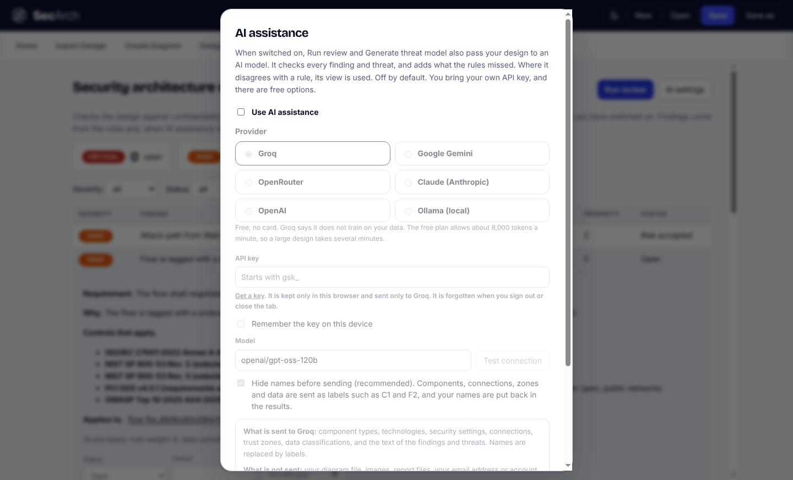

1. Open **View, AI settings...** (or click **AI settings** on the review or threat model tab).
2. Tick **Use AI assistance**, choose a provider, paste your key, click **Test connection**.
3. Keep **Hide names before sending** ticked.
4. Tick the agreement, click **Done**.

Full instructions, costs and what is sent: **[Optional AI assistance](ai-assistance.md)**.

## 12. A complete worked example

This takes about ten minutes and uses only the built in example.

1. Start SecArch. On **Home**, click **Import a design**.
2. On **Import Design**, open **Or paste the design text** and click **Use an example**. The text describes a payments platform: a mobile app, an API gateway, a payment service, an orders database, a card processor, a SIEM and an admin portal.
3. Click **Read the text**. Check the **What was found** summary. Leave the method as **STRIDE**.
4. Click **Build diagram only**.
5. Open **Create Diagram**. Move shapes if you want to tidy the layout. Select the flow from the gateway to the payment service and set **Encrypted in transit** to yes and **Authentication** to mtls.
6. Open **Design Summary**. Under **Scope questions** tick **Card payments are in scope**. Under **Data assets** click **Add data asset**, name it `Card data`, classify it **Restricted**, tag it `cardholder-data`, and tick the orders database under **Stored in**.
7. Open **Review Security Design** and click **Run review**. Open the highest finding, read **Requirement** and **Controls that apply**, set a **Status** and **Owner**.
8. Open **Create Threat Model** and click **Regenerate**. Open the top threat and choose a **Treatment**.
9. Open **Generate Reports** and download the review PDF.
10. Press **Ctrl or Cmd + S** and save the project as `payments-example.secarc`.

Close and reopen the app, then use **File, Open Recent** to return to it.

## 13. Tips for a good review

* **Say what you know.** Replace **unknown** with **yes** or **no** wherever you can. The review never treats unknown as safe, so each unknown can appear as a gap.
* **Draw trust boundaries.** Zones and their trust levels change how severe flows between them are.
* **Classify your data.** Findings that touch Restricted data score higher.
* **Work top down.** Fix the highest severity findings first, change the design, then run the review again.
* **Record decisions.** Use **Status**, **Owner**, **Due** and **Justification** so the report shows who accepted what.
* **Switch on only the standards you need.** The **Scope questions** and **Content packs** keep the report focused.
* **Save often.** Press Ctrl or Cmd + S after each step.

## 14. Limits you should know about

* SecArch supports a security review. It is **not** a certification, an audit opinion or legal advice.
* The standards, rules and threat library shipped with the app are marked **draft** until a specialist reviews them against the published standards. Reports say so.
* A rule can only show that a control is addressed or has a gap. Controls no rule tests are shown as **Not tested** and are never counted as met.
* The review can only judge what the design states. What you leave unknown is reported as unknown.
* AI assistance, when you switch it on, can be wrong. Check its results like any other finding.

Need help? See [Troubleshooting](troubleshooting.md) or open an issue in this repository.
